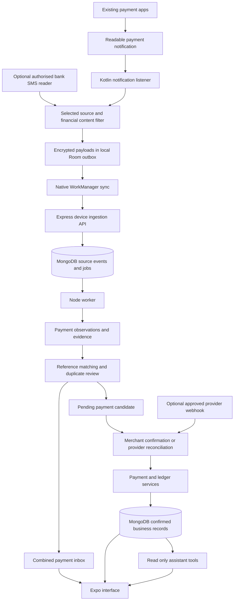

# Automatic Payment Tracking Architecture for the Merchant App

Architecture date: 17 October 2026.

Build an Android app that collects supported payment alerts from the shopkeeper's existing payment apps, combines them into one payment inbox, and connects reviewed payments to customers, bills and khata. The merchant keeps using their existing payment apps and QR codes. Routine capture requires no file upload or typing.

Use React Native Expo for the interface, a small Kotlin module for Android capture and background sync, and Express with MongoDB for business records. Start with notification capture. Bank SMS is a separate, optional integration. Add direct merchant-provider integrations later when approved access is available.

This is the current payment architecture for the broader Merchant Assistant. It replaces the earlier decision to require a Razorpay connection as the first payment source. WhatsApp, documents, sales, voice and the wider ledger design remain in the [general app architecture](<C:/Users/abdul muqeet/Documents/Codex/2026-10-16/so-x20/outputs/expo-mern-app-architecture.md>).

## 1 What automatic tracking means

The first release automatically imports new, readable transaction alerts on the enrolled Android phone. GPay, PhonePe, their business variants and banks need separate format adapters and device testing. An installed app is not automatically a supported source.

| Situation | Behavior |
|---|---|
| A supported payment app posts a readable transaction notification on the shopkeeper's phone | Capture and parse it after notification access is enabled |
| A supported bank sends a transaction SMS | Import only when the separate SMS feature is enabled and its permission requirements are met |
| A customer pays from GPay to the merchant's PhonePe account | Capture the alert delivered to the merchant's phone; the customer's choice of app may be unknown |
| The same transfer produces an app alert and a bank alert | Attach both observations to one transaction when reliable references establish the match |
| The payment generates no readable alert | It may be missed; show source coverage and allow reconciliation |
| The merchant wants all previous GPay or PhonePe history | Notification access does not expose complete historical app records |
| A notification says payment pending or failed | Display its state without counting it as received money |
| An alert has an amount but no reliable customer identity | Import it into the unmatched inbox; do not guess the customer's khata |

Android exposes notification callbacks through `NotificationListenerService`. Notifications contain source-package information, but they are observations on a device, not signed payment-provider confirmations. Work profiles and some older low-memory devices have additional restrictions. [Android notification listener reference](https://developer.android.com/reference/android/service/notification/NotificationListenerService)

Target Android for this capture feature. Do not promise that this Android listener works on iPhone, that every payment creates a usable alert, or that every alert identifies the originating payer app.

## 2 Main system flow



Capture, extraction, matching and confirmation are separate stages. A clear amount can be imported automatically even when the customer or final payment status still needs review.

## 3 Stack and free development setup

| Component | Choice | Purpose |
|---|---|---|
| Mobile interface | Expo, React Native, TypeScript, Expo Router | Dashboard, sources, payment inbox, customers, khata and assistant |
| Data fetching | TanStack Query | Server records, pagination and refresh |
| Android integration | Local Expo module written in Kotlin | Notification access, native capture status and background ingestion |
| Local persistence | Android Room | Durable capture outbox, attempts and acknowledgements |
| Local payload protection | AES GCM with a key protected by Android Keystore | Encrypt financial payloads and device credentials at rest |
| Background sync | Android WorkManager | Retry persisted batches when connectivity permits |
| API | Node.js, Express, TypeScript, Zod | Authentication, ingestion and business commands |
| Database | MongoDB and Mongoose | Original observations, matching, payments and ledger |
| Server jobs | MongoDB jobs collection plus a Node worker | Parsing, duplicate detection, matching and retries |
| Capture parsing | Versioned deterministic rules | Extract transaction fields without paying for an AI call per alert |
| Live interface refresh | Socket.IO invalidations plus REST catchup | Show newly processed records while the app is open |
| AI | Existing assistant service, optional local model | Explain already calculated records; never determine money by guessing |

Room is a SQLite persistence library; using it alone does not encrypt the database. Encrypt the sensitive payload fields before insertion and minimise unencrypted metadata. [Room documentation](https://developer.android.com/training/data-storage/room), [Android Keystore](https://developer.android.com/privacy-and-security/keystore)

Native capture requires a development build that includes this Kotlin module. Expo Go cannot load an arbitrary new native service. Use a local Expo module and build with `npx expo run:android`; rebuild after native changes. [Expo modules](https://docs.expo.dev/modules/overview/), [Expo development builds](https://docs.expo.dev/develop/development-builds/introduction/)

For a free development setup, run the API and worker on the laptop, use a local MongoDB replica set or the existing Atlas free cluster, and build Android locally with the Android SDK and JDK installed. The phone accesses the laptop's LAN address; development HTTP must not become a production default. Local builds and parsing avoid per-alert service charges. Check current hosted database, deployment and distribution limits before release.

## 4 Onboarding and source selection

1. Sign in and choose the shop that owns this phone's business capture.
2. Register a device binding with the server. Assign a random installation ID rather than collecting IMEI or hardware identifiers.
3. Explain which financial alerts will be processed, what stays on the phone and what syncs to the shop account. Obtain consent before enabling capture.
4. Show only supported payment applications detected through narrowly scoped Android package queries. Avoid requesting unrestricted installed-app visibility. [Android package visibility](https://developer.android.com/training/package-visibility/declaring)
5. Let the merchant choose sources and, where distinguishable, business account aliases. Explain that one payment app can contain both personal and business activity.
6. Open Android's notification-access settings. On return, check actual access instead of treating the button press as a grant.
7. Save the source selection and consent version natively. Capture must work without a mounted React screen.
8. Show listener availability, last local capture and last server acknowledgement separately. A healthy listener does not prove that a payment app emitted all alerts.

The active capture binding remains fixed to one shop. Changing the shop shown in the UI must not relabel queued events. To move capture to another shop, pause, resolve or explicitly discard pending events, revoke the old binding and enrol the new one.

Provide separate controls for pause, disconnect and deletion. Disconnect stops capture, cancels pending sync and revokes the device credential; show the merchant any unsynced count before discarding it. Already confirmed business entries follow the existing correction and retention rules.

## 5 Native Android capture module

Create a local Expo module named `merchant-capture`. Keep the platform-specific work inside it so the rest of the app remains familiar React and TypeScript.

| Native component | Responsibility |
|---|---|
| `PaymentNotificationListener.kt` | Receive new/updated notifications; snapshot bounded text and source metadata |
| `FinancialAlertFilter.kt` | Enforce selected packages; reject unrelated content, OTPs, offers and group summaries |
| `CaptureRepository.kt` | Encrypt and persist accepted financial snapshots, with a stable capture ID |
| `CaptureSyncWorker.kt` | Upload bounded batches, process per-item acknowledgements and retry |
| `CaptureCredentialStore.kt` | Store the scoped ingestion credential using Keystore-backed protection |
| `MerchantCaptureModule.kt` | Expose settings, status and pause/resume methods to TypeScript |

`onNotificationPosted` should return quickly. Snapshot the relevant fields, then perform filtering, encryption and database work on native background execution. Do not run network calls or an LLM on the listener callback. Persist to Room before scheduling sync. Notification capture itself is best effort; process death before persistence can lose an alert.

Suggested TypeScript bridge surface:

```typescript
type CaptureConfiguration = {
  bindingId: string;
  ingestToken: string;
  consentVersion: string;
  selectedPackages: string[];
};

type CaptureStatus = {
  notificationAccessGranted: boolean;
  listenerConnected: boolean;
  captureEnabled: boolean;
  pendingCount: number;
  lastCapturedAt: string | null;
  lastAcknowledgedAt: string | null;
  lastErrorCode: string | null;
};

interface MerchantCaptureBridge {
  configureCapture(config: CaptureConfiguration): Promise<void>;
  openNotificationAccessSettings(): Promise<void>;
  getCaptureStatus(): Promise<CaptureStatus>;
  pauseCapture(): Promise<void>;
  resumeCapture(): Promise<void>;
  requestSync(): Promise<void>;
  disconnectCapture(): Promise<void>;
}
```

The token is supplied during enrolment and never returned by a status call. React events can refresh an open screen, but React listeners are not the delivery mechanism for persisted payment data.

Configure the encryption key for the intended background operation after device unlock; requiring a fresh biometric interaction for every key use would prevent unattended capture and sync. Handle unavailable or invalidated keys by stopping the affected operation and showing recovery status. Protect access to the app's financial interface separately.

After reconnecting, examine currently active notifications if available and run them through the same duplicate checks. This can recover some current alerts; it is not a historical transaction-history import. Notification removal or dismissal does not mean a payment was cancelled or refunded.

## 6 Local outbox and background sync

Local table `capture_outbox`:

```text
captureId                     UUID, stable across upload retries
bindingId                     immutable shop and device association
sourceKind                    android_notification | bank_sms
sourcePackage                 nullable for SMS
captureFingerprint            hash for local repeated-snapshot detection
encryptedFinancialPayload     filtered financial text and required metadata
capturedAt                    device timestamp
state                         queued | syncing | acknowledged | rejected
attemptCount, nextAttemptAt, lastErrorCode
serverEventId                 nullable until acknowledged
```

Persist the capture ID and payload together. A batch timeout must reuse the same capture IDs. Keep notification key, post time and financial-content hash as capture metadata; notification keys can be reused, so none is a universal bank transaction ID.

Schedule unique one-time WorkManager work when the queue changes, with network connectivity required. Drain in bounded batches, for example at most 50 events with small per-item and total body limits. Recheck queued work after startup and completion so new events cannot be stranded during a running upload. A periodic sweep is a recovery mechanism, not an exact timer.

WorkManager persists scheduled work across restarts and reboots, while observing system power constraints. Upload timing is therefore best effort. Opening the app can request an immediate drain, but must not be required for every event. Force-stop, revoked permissions and device restrictions need visible recovery states. [Android persistent work](https://developer.android.com/develop/background-work/background-tasks/persistent)

For each batch result:

- Mark only durably accepted or already accepted items acknowledged.
- Retry timeouts, connectivity errors and transient server failures with backoff.
- Stop on revoked credentials and show re-enrolment status; do not retry a permanently revoked token forever.
- Retain permanently rejected items locally with a bounded error summary for review; avoid infinite retries.
- Remove acknowledged financial payloads after the configured short retention period, for example seven days. Exclude native credentials and pending payloads from automatic cloud backup.

Bound the queue by count and bytes. If storage is full or the configured bound is reached, report a capture gap and require recovery; never silently delete unacknowledged events or report complete coverage.

## 7 Device credentials and ingestion API

The logged-in merchant registers the phone through an ordinary authenticated API call. The server checks shop membership and enrolment permission, then issues a separate random ingestion token. Store its hash on the server and protect the token in native storage.

An ingestion token can append observations and report capture health for its own binding. It cannot read other records, create users, change a party balance or mark a payment verified. Bind shop, environment and source permissions server-side. Device authentication establishes who submitted the observation; it does not prove that a bank confirmed it.

| Endpoint | Caller | Purpose |
|---|---|---|
| `POST /v1/shops/:shopId/capture-bindings` | Signed-in owner | Enrol this installation and issue scoped credentials |
| `PATCH /v1/capture-bindings/:id` | Authorised owner | Update allowed sources, pause or disconnect |
| `GET /v1/shops/:shopId/capture-bindings` | Authorised member | Source health and coverage |
| `POST /v1/device/events/batch` | Scoped native credential | Persist accepted financial observations |
| `POST /v1/device/health` | Scoped native credential | Report permission and sync health without broad device data |
| `GET /v1/shops/:shopId/payment-inbox` | Authorised member | Paginated grouped transactions and review states |
| `POST /v1/shops/:shopId/payments/:id/confirm` | Authorised merchant | Confirm a pending candidate with a unique command key |
| `POST /v1/shops/:shopId/payment-observations/:id/resolve` | Authorised merchant | Correct extraction, classify business use or resolve matching |

The ingestion API derives `shopId`, `bindingId` and `mode` from the validated credential. Reject body fields that attempt to override them or declare financial verification. Enforce schema limits, rate limits and selected-source restrictions.

In one MongoDB transaction, insert each accepted source event and its processing job. Return acceptance only after commit. Each item is independently idempotent; a later item failing does not invalidate earlier committed items. Return per-item results so a malformed capture does not block the queue. Conflicting content under the same capture ID is an error, not a replacement.

## 8 Capture payload and acknowledgements

The following is a fictional example of a filtered financial alert. It represents the device's report of an alert, not the provider's signed data. Actual GPay and PhonePe wording must come from tested device samples.

```json
{
  "events": [
    {
      "captureId": "b3f09cb1-f42f-4ba8-9480-41505c97106b",
      "sourceKind": "android_notification",
      "sourcePackage": "supported.payment.app",
      "sourceAppLabel": "Supported payment app",
      "postedAt": "2026-10-17T10:30:00+05:30",
      "capturedAt": "2026-10-17T10:30:01+05:30",
      "financialExcerpt": "Received INR 200.00 from Roy. Ref DEMO-UPI-001.",
      "parserVersion": "notification-adapters-1",
      "consentVersion": "capture-consent-1"
    }
  ]
}
```

Example successful response:

```json
{
  "results": [
    {
      "captureId": "b3f09cb1-f42f-4ba8-9480-41505c97106b",
      "result": "accepted",
      "sourceEventId": "event_roy_200"
    }
  ],
  "serverReceivedAt": "2026-10-17T05:00:03Z"
}
```

Valid item outcomes are `accepted`, `already_accepted`, `rejected` and `retry_later`, with machine-readable error codes for the latter two. An acknowledgement means the event is stored; extraction and payment confirmation may still be pending.

## 9 Parsing and matching

Implement separate adapters for each supported package and tested format. Track language, version and sample coverage in an adapter registry. Distinguish GPay from Google Pay for Business and PhonePe from PhonePe Business rather than assuming identical messages.

The parser emits:

```text
amountPaise, currency
direction: in | out | unknown
reportedStatus: success | pending | failed | reversal | unknown
method: upi | bank_transfer | card | other | unknown
counterpartyName: nullable
counterpartyVpa: nullable
transactionReference: nullable
referenceNamespace: nullable
accountAlias: nullable
transactionAt: nullable
sourcePostedAt, capturedAt, serverReceivedAt
parserVersion
extractionState: parsed | needs_review | unsupported
```

Use integer paise: INR 200.00 becomes `20000`. Preserve the original observed time and the server receive time. If the alert has no transaction time, mark the time basis as notification time; do not pretend it is the bank transaction timestamp. Use the shop timezone for date grouping.

Do not infer success from an amount alone. Exclude requests, offers and balance-only messages from payment totals. Pending and failed alerts can update the same transaction candidate when references match. A late failure must not automatically erase a previously confirmed financial movement. A possible reversal requires its own review or authoritative provider reconciliation.

Match a party only through a previously confirmed identity mapping or reliable transaction-to-document reference. A nickname and the amount INR 200 are insufficient. Personal transfers, owner funding and supplier refunds must not become sales merely because money came in.

## 10 Duplicate detection

There are two different duplicate problems.

**Delivery duplicates:** the phone retries the same capture. Enforce unique `(bindingId, captureId)` and compare a canonical payload hash. Return the original acknowledgement for identical content.

**Transaction duplicates:** different captures describe one money movement. Prefer a shared bank or UPI reference, normalised reference namespace, direction, currency, amount and compatible business-account context. Account aliases must be explicitly mapped before treating bank and app alerts as the same account.

Apply these rules:

1. Repeated snapshots of the same notification do not create new payments.
2. Matching reliable transaction references attach evidence to an existing candidate. Validate amount and direction; conflicts require review.
3. Equal amount, time and payer name alone produce a possible-duplicate group. Never silently discard one: two legitimate INR 200 payments can occur a minute apart.
4. Keep unresolved groups out of observed receipt totals and show their pending count. The inbox can still display the underlying observations.
5. If a provider-confirmed payment later matches a pending candidate, attach the observations to it. Do not create a second receipt.
6. If two candidates were already confirmed before discovering the duplicate, correct the ledger using explicit reversing history and a reviewed merge. Do not merely hide one row.

An authenticated device may submit misleading content. Package metadata and local hashes help normalisation and transport integrity; they are not cryptographic verification by GPay, PhonePe or a bank.

## 11 Database collections

Reuse the broader application's `users`, `shops`, `sessions`, `parties`, `documents`, `connections`, `records`, `payments`, `allocations`, `ledger_entries`, `review_tasks`, `jobs`, `domain_events` and `assistant_runs`. Add two collections and extend three existing schemas below.

### Capture bindings

Collection `capture_bindings`:

```text
_id, shopId, connectionId, enrolledByUserId
installationId, mode: demo | test | live
selectedPackages, accountMappings
consentVersion, consentedAt, syncConsentEnabled
status: active | paused | revoked
ingestTokenHash, tokenExpiresAt, credentialVersion
notificationAccessReported, listenerConnectedReported
lastHealthAt, lastCapturedAtReported, lastAcceptedAt
reportedQueueCount, coverageStartedAt, coverageGaps
createdAt, revokedAt
```

Index `(shopId, status)` and enforce one active shop capture binding per enrolled installation. A reinstall creates a new installation identity. Device-reported health is diagnostic, not proof of complete coverage. Do not store financial events inside this growing document.

### Source events

Extend `source_events`:

```text
provider: android_notification | bank_sms | existing_provider
bindingId: nullable
eventKey: capture UUID for a device event
authenticity: device_authenticated | signature_verified | internal_authorised | simulated
rawPayload: bounded filtered financial fields only
```

Keep the existing unique `(shopId, connectionId, eventKey)` index and add a partial unique `(bindingId, eventKey)` index where `bindingId` exists. Events reference the binding's connection. Store canonical payload hashes and received time. `device_authenticated` is explicitly weaker than provider signature verification.

### Payment observations

Collection `payment_observations`:

```text
_id, shopId, sourceEventId, recordId, bindingId
mode: demo | test | live
sourceKind, sourcePackage, sourceAppLabel
amountPaise: nullable, currency, direction, reportedStatus
transactionReference: nullable, referenceNamespace: nullable
counterpartyName: nullable, counterpartyVpa: nullable
accountAlias: nullable, businessClassification: business | personal | unknown
occurredAt: nullable, timeBasis: transaction | notification | unknown
capturedAt, receivedAt, parserVersion
extractionState: parsed | needs_review | unsupported
duplicateState: unique | linked | possible_duplicate
duplicateGroupId: nullable, paymentId: nullable, suggestedPartyId: nullable
reviewState: unreviewed | accepted | rejected
revision, createdAt, updatedAt
```

Unique `sourceEventId` ensures worker retries do not produce repeated observations. Index `(shopId, mode, receivedAt)`, `(shopId, reviewState, receivedAt)` and the non-unique normalised transaction reference. Reference collisions must reach matching logic rather than being silently dropped by an overbroad unique index. Preserve reparse history in the linked record and audit trail.

### Evidence records

Extend `records.source` with `android_notification` and `bank_sms`, and `records.kind` with `payment_alert`. Store a minimal financial excerpt, source application, capture times and parser revision. Where sensitive fields are omitted, label the displayed material as an excerpt rather than a complete original message. Personal messages and OTPs never become records.

### Canonical payments

Retain the existing `payments.status` values `pending | confirmed | failed`. Add `device_alert` to `verification` and nullable `observationIds` or an equivalent reverse relation. A detected successful alert starts as:

```json
{
  "_id": "payment_roy_200",
  "shopId": "shop_demo",
  "mode": "demo",
  "kind": "receipt",
  "direction": "in",
  "method": "upi",
  "amountPaise": 20000,
  "currency": "INR",
  "status": "pending",
  "verification": "device_alert",
  "recognisedAt": null,
  "partyId": null,
  "sourceRecordIds": ["record_roy_alert"],
  "observationIds": ["observation_roy_200"]
}
```

Keep `providerResourceKey` null until a real provider resource is associated. Successful-looking notification text is not `providerStatus=captured`. A provider webhook is the only route in this design to `provider_confirmed`; an authorised merchant can instead confirm it as `merchant_recorded`, while retaining its alert evidence and confirmation actor.

## 12 Confirmation and khata

Automatically put supported alerts into the inbox. Keep pending alert candidates outside the confirmed ledger until an authorised merchant confirms the movement or an approved provider integration reconciles it.

If the customer is unknown, the merchant can confirm the incoming money as an unmatched receipt. It stays outside any customer's ledger until classification. A confirmed party mapping can suggest Roy next time; it does not upgrade the payment's verification level.

Example:

1. A confirmed credit sale for Roy posts `+50000` paise to his receivable.
2. A notification reports an incoming `20000` paise. The inbox updates automatically; confirmed khata is still INR 500.
3. The merchant confirms the payment and Roy's identity. In one database transaction, change the payment to confirmed, set recognition time, insert a `-20000` paise ledger entry and write the audit/outbox event.
4. Roy's confirmed receivable becomes INR 300. The evidence says merchant confirmed from a device alert, not bank verified.
5. If allocated to Roy's invoice, the allocation reduces invoice dues without posting the receipt to the party ledger again.

Use a unique confirmation command key and unique ledger posting key such as `payment:payment_roy_200:recognise`. Atomically check the candidate's current revision so two taps cannot post it twice. Preserve later refunds and corrections as separate movements or reversing entries, consistent with the main ledger design.

For an optional provider integration, auto-confirm only after signature validation, authoritative status checks and reliable account/reference matching. A matching amount alone is insufficient. Keep live provider setup outside the initial alert-capture milestone.

## 13 Interface screens and totals

Use four main tabs: **Home**, **Payments**, **Khata** and **Ask**. Put capture settings under Sources. WhatsApp and documents join the broader searchable history without adding more tabs to the first demo.

| Screen | Render |
|---|---|
| Home | Recorded sales, confirmed receipts, imported unconfirmed receipts, outstanding dues, review count and source coverage |
| Payments | Combined incoming/outgoing feed, app source, time, reported status, trust label and duplicate/review state |
| Payment detail | Financial excerpt, extracted fields, linked observations, candidate/customer match and confirmation history |
| Review | Missing amount, ambiguous status, personal/business classification, unknown party and possible duplicates |
| Khata | Customer balance from confirmed ledger entries, linked bills and payment evidence |
| Ask | Native-language questions answered with deterministic totals and evidence links |
| Sources | Selected applications, permissions, enrolment, pause/disconnect, local queue and last accepted sync |

Keep these totals distinct:

- **Imported unconfirmed receipts:** grouped successful-looking business receipt candidates still awaiting confirmation; exclude possible duplicates and unknown/failed/pending-status observations.
- **Confirmed receipts:** eligible confirmed incoming money movements, counted once.
- **Recorded sales:** confirmed sales documents, adjusted by the established sales correction rules.
- **Customer dues:** confirmed receivable ledger entries.

When a candidate becomes confirmed, remove it from the unconfirmed total and include it once in confirmed receipts. Neither total proves bank settlement. A notification source labelled PhonePe does not establish that the customer paid through PhonePe; expose `payerApp=unknown` unless the source explicitly supplies it.

Source state should say, for example, "Tracking selected alerts since 17 October; phone last synced at 3:40 pm." A stale phone heartbeat creates a coverage warning, not an assertion that no payments occurred.

## 14 Assistant behavior

Give the assistant scoped read tools such as `getRecordedSales`, `getConfirmedReceipts`, `getImportedUnconfirmedReceipts`, `getPartyBalance` and `getPaymentEvidence`. Server code calculates the numbers. The assistant explains them in the selected language and links the supporting records.

For "Roy ne kitna diya?", distinguish a confirmed INR 200 receipt from an alert that merely reports INR 200. For "Aaj kitni bikri hui?", use sales documents rather than summing bank credits. If source coverage is incomplete, include that fact with the answer.

Voice entry can create a proposed sale or cash receipt for confirmation. AI never directly edits a ledger, approves duplicates or changes alert verification.

## 15 Privacy and operational boundaries

Process only selected financial sources. Apply the package filter and financial-content checks on the phone before persistence or upload; reject OTPs and unrelated notifications. A source being selected is not permission to upload its entire notification stream.

Cloud sync needs explicit disclosure and consent distinct from Android's notification-access toggle. Upload the minimum financial excerpt and fields needed for the product. Mask full account identifiers in the interface and do not place raw financial text, access tokens or notification bodies in logs or crash reports.

Use TLS outside the local demo. Encrypt pending payloads and native credentials, enforce shop membership on all read and business-write routes, revoke device ingestion independently of normal sessions, and clean local data on logout. Binding revocation stops upload immediately; ordinary permission revocation must also stop future capture.

Use bounded retention for raw observations and preserve only authorised business evidence for as long as needed. Offer deletion controls for unconfirmed captures. Confirmed financial history requires an explicit correction or deletion workflow so references and balances are not left inconsistent.

## 16 Optional bank SMS integration

Implement SMS as a separate feature flag and adapter. Request only the permissions needed for an approved money-management use case, with runtime consent and Play declarations. Google Play lists SMS-based money management as a potential exception, subject to review; permission is not guaranteed. Do not change the default SMS app or read the Messages notification stream as a hidden workaround. [Google Play SMS policy](https://support.google.com/googleplay/android-developer/answer/10208820?hl=en)

Parse only transaction messages locally. Retain no OTPs or personal messages. A user-authorised historical bank-SMS import can offer partial historical coverage, but it does not expose missing messages or another app's private history. Reuse the same outbox, observation, matching and confirmation services.

Bank SMS often identifies the bank/account and UPI transfer without revealing whether the customer used GPay or PhonePe. Keep that app field unknown instead of inventing it. The notification-only demo must work with this feature disabled and SMS permissions absent from that build.

## 17 Repository layout

```text
apps/
  mobile/
    app/                          Expo Router screens
    src/features/capture/         Onboarding and source health UI
    src/features/payments/        Feed, detail and review UI
    src/features/khata/           Customer ledger UI
    src/features/assistant/       Read only answers and voice drafts
    src/lib/api/                  Ordinary authenticated client
    modules/merchant-capture/
      android/src/main/java/.../
        PaymentNotificationListener.kt
        FinancialAlertFilter.kt
        CaptureRepository.kt
        CaptureSyncWorker.kt
        CaptureCredentialStore.kt
        MerchantCaptureModule.kt
      src/                        TypeScript bridge definitions
  api/
    src/modules/capture/          Binding and device ingestion routes
    src/modules/observations/     Parsing, grouping and reviews
    src/modules/payments/         Confirmation and provider reconciliation
    src/modules/ledger/           Posting, allocation and corrections
    src/modules/reporting/        Deterministic totals
    src/modules/assistant/        Authorised read tools
  worker/
    src/jobs/                     Normalise, parse, match and reconcile
packages/
  contracts/                      Zod schemas, enums and API types
  payment-parsers/                Pure TypeScript server adapters
  capture-fixtures/               Fictional format samples and expected fields
```

Native filtering handles allowlists and minimisation; authoritative server parsers handle normalisation and business checks. Give both explicit versions. Updating server parsing can reprocess retained financial evidence without asking the merchant to upload it again.

Use the main architecture's MongoDB jobs with atomic claims, expiring leases, fencing and idempotent handlers. Server restarts must resume queued source events without replaying financial postings.

## 18 Build order and decision gates

| Stage | Build | Completion evidence |
|---|---|---|
| 1 | Kotlin capture feasibility on the actual Android phone | With consent, inspect whether the selected GPay/PhonePe variants emit useful alerts; record supported languages and fields |
| 2 | Native financial filtering, encrypted Room outbox and status bridge | A supported sample is stored while the React screen is closed; unrelated text is discarded |
| 3 | Scoped binding credentials and WorkManager batch sync | Offline capture survives restart and synchronises after connectivity returns |
| 4 | Server observations, adapter registry and combined inbox | New supported alerts appear automatically with evidence and trust labels |
| 5 | Delivery deduplication, transaction matching and review | A replay stays one record; two real equal-amount payments stay distinguishable |
| 6 | Merchant confirmation, customers, ledger and allocations | Roy's INR 500 balance becomes INR 300 after one confirmed INR 200 receipt |
| 7 | Home totals and native-language assistant | Answers separate sales, confirmed receipts and unconfirmed imports |
| 8 | Optional bank SMS or approved provider adapter | Additional coverage uses the same evidence and business services |

The first gate determines what can honestly be demonstrated. If an app provides only generic or hidden alerts on the test phone, show it as unsupported or limited. Do not spend the hackathon building a dashboard before proving capture on the device.

## 19 Hackathon demo sequence

1. Open Sources and show the selected apps, granted access and healthy device binding.
2. Open Roy's account with a confirmed INR 500 credit sale.
3. Receive a readable payment alert on the enrolled phone. Use a real, explicitly authorised small transaction only if available; otherwise use a clearly labelled fictional fixture.
4. Show the payment appearing automatically in the combined inbox. Open its excerpt and detected INR 200 amount.
5. Show an initially unmatched or unconfirmed state, then confirm Roy and the receipt. His confirmed khata becomes INR 300.
6. Replay the capture. The inbox and ledger totals remain unchanged.
7. Turn off internet, capture another supported sample, show the queued state, and restore connectivity to demonstrate recovery.
8. Ask in Hindi for Roy's balance and open the sale/payment evidence behind the answer.

Keep demo/test/live environments isolated. A demo-only fixture source uses its own package allowlist and server binding, visibly marked as simulated; production bindings reject it. A fixture that exercises the pipeline does not prove that actual GPay or PhonePe notifications were captured. Never label a simulated payment provider verified.

This architecture does not require scanning a provider-generated Test QR. If a later Razorpay demonstration uses actual QR scanning, its QR documentation requires Live mode; enabling QR access and merchant activation are separate steps. [Razorpay QR FAQ](https://razorpay.com/docs/payments/qr-codes/faqs/), [Razorpay QR access](https://razorpay.com/docs/payments/qr-codes/)

## 20 Acceptance checks

1. Selected, supported alerts are captured without an open React screen; actual device support is recorded.
2. Unselected apps, personal messages, OTPs, offers and group summaries do not become uploaded records.
3. Revoking notification access stops new capture and appears in Sources after status refresh.
4. An offline capture persists across ordinary app/process restart and retries with the original capture ID.
5. A server timeout after commit followed by a retry produces one source event and one observation.
6. Reusing a capture ID with different content is rejected without overwriting evidence.
7. Notification updates and duplicate bank/app alerts do not double-post a receipt.
8. Two legitimate INR 200 transfers are not silently merged because their amounts and names match.
9. A pending or failed alert does not increase received-money totals or reduce customer dues.
10. An unconfirmed success alert stays outside confirmed khata and provider-verified totals.
11. Confirmation retries post exactly one receipt; Roy's INR 500 less INR 200 equals INR 300.
12. A confirmed receipt allocated to an invoice is not posted to the customer ledger twice.
13. Unknown customer identity and personal/business ambiguity create review tasks.
14. A device credential cannot choose another shop, read shop data or self-approve a payment.
15. Switching the displayed shop does not relabel the capture queue; revoked bindings stop ingestion.
16. Queue delays and stale source health produce visible coverage warnings.
17. Confirmed and unconfirmed receipts remain separate from recorded sales in screens and assistant answers.
18. Duplicate merges, reversals and refunds preserve reviewed correction history.
19. The notification-only build runs with SMS access disabled and no SMS permission request.
20. Demo fixtures remain visibly simulated and cannot enter live bindings or live totals.

The first implementation target is **supported Android alert → encrypted local outbox → authenticated batch ingestion → MongoDB observation → combined payment inbox**. Complete that path before adding SMS, more payment apps or an AI matching layer.
