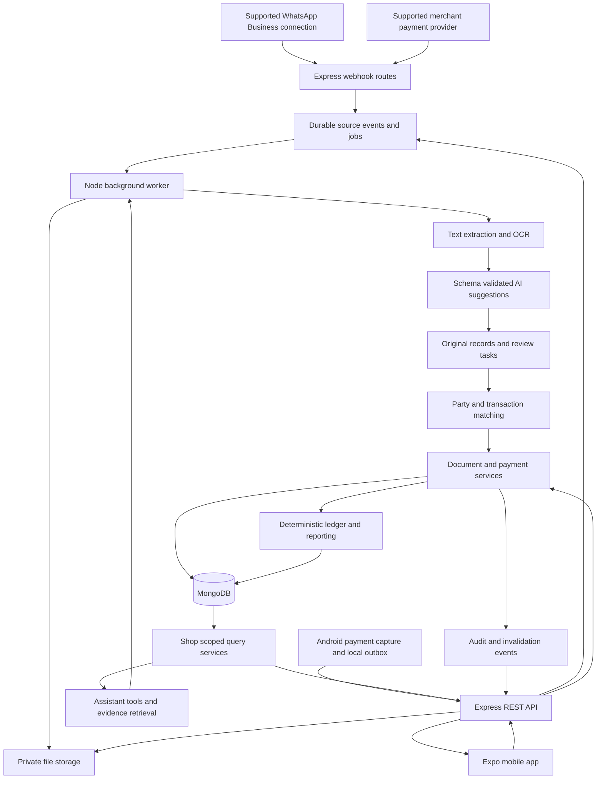
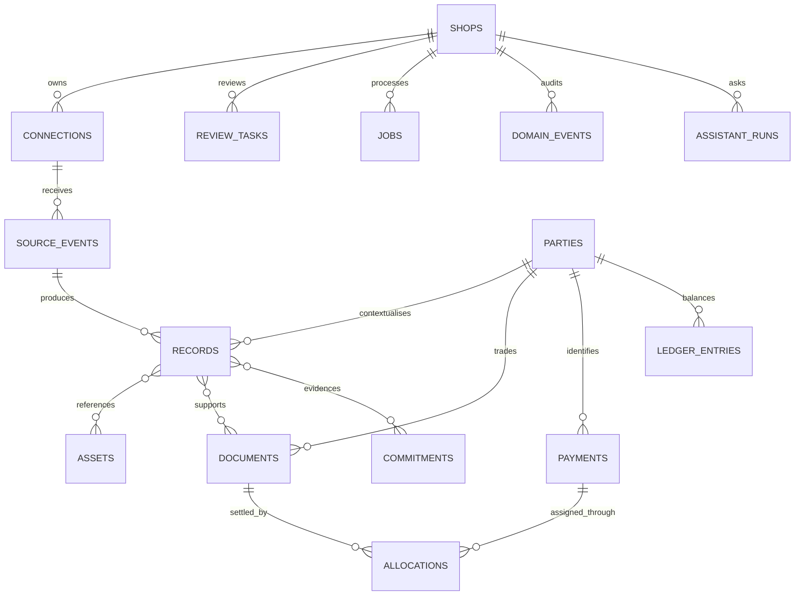
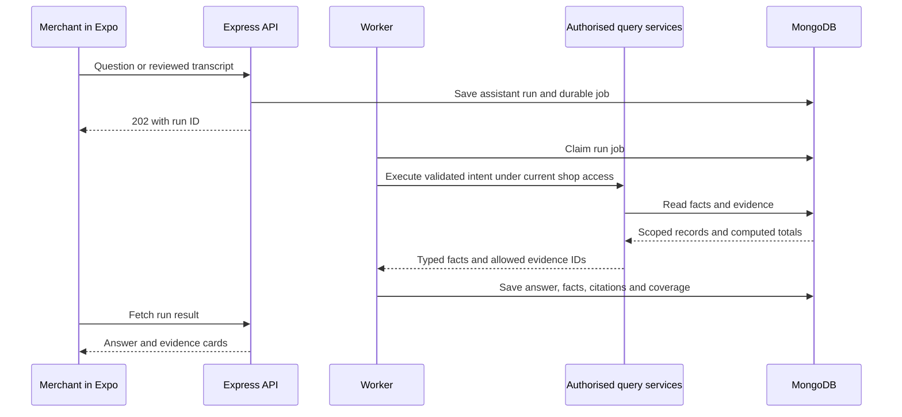

# Expo and MERN Architecture for the Merchant Assistant

Architecture date: 17 October 2026.

Current payment design: use the [automatic payment tracking architecture](<C:/Users/abdul muqeet/Documents/Codex/2026-10-16/so-x20/outputs/automatic-payment-tracking-architecture.md>) for Android notification capture, optional bank SMS, device ingestion, pending observations and merchant confirmation. It replaces the earlier requirement to start with a payment-provider connection. The device schemas and payment rules in that document take precedence for this source; direct provider integrations remain optional.

Build an Android-first Expo app with an Express API, MongoDB and a background worker. The app brings supported WhatsApp records, merchant payment records and in-app sales or notes into one searchable business history. Confirmed records drive khata and sales calculations; an AI assistant retrieves and explains those results in the merchant's language.

The first release is for merchants and their staff. A separate customer app and shared QR approval flow can use the same backend later. Start with INR, shop timezone Asia/Kolkata, one owner and a small dataset. This is a proposed implementation blueprint, not an already implemented app.

## 1 Product boundaries

The merchant should be able to:

1. Connect a supported WhatsApp Business number and enable supported Android payment-alert capture; optionally connect a merchant payment provider for direct reconciliation.
2. Find messages, bills, quotations, payments and notes together.
3. Open a customer's or supplier's related records.
4. Review an extracted sale before confirming it.
5. Record cash and credit transactions through a short form or voice draft.
6. See recorded sales, receipts, customer dues and unfinished commitments.
7. Ask a question and inspect the evidence behind the answer.

Use an explicit review task when identity, amount, transaction matching or agreement status is unclear. An incoming order request, payment screenshot or AI suggestion does not itself establish a completed sale or verified payment.

## 2 Stack decisions and costs

| Area | Choice | Reason and free-use boundary |
|---|---|---|
| Mobile app | React Native, Expo and TypeScript | Familiar React development; Android-first demo |
| Navigation | Expo Router | Routes, tabs and customer detail pages |
| Server data | TanStack Query | Fetching, caching, mutation status and refresh |
| Small UI state | Zustand | Language, selected shop and unsaved UI state |
| API | Node.js, Express, TypeScript and Zod | Fits MERN knowledge; server-side input validation |
| Database | MongoDB Atlas Free and Mongoose | Free tier has 512 MB for data and indexes; keep media outside MongoDB. [Atlas comparison](https://www.mongodb.com/docs/atlas/manage-clusters/) |
| Background jobs | A MongoDB jobs collection | Durable queue without a separate Redis subscription |
| Local file storage | Private directory on the development laptop | No storage account required for the local demo |
| Hosted file storage | Supabase Storage private bucket | Free plan currently includes 1 GB of files; projects can pause after a week of inactivity. MongoDB remains the business database. [Supabase pricing](https://supabase.com/pricing) |
| Local AI | Ollama with a multilingual model | No per-request hosted API charge; consumes your laptop's compute. Begin by evaluating [qwen3:4b](https://ollama.com/library/qwen3:4b), not assuming it is accurate enough for every language |
| Optional hosted AI | Gemini Developer API free tier | Use fictional or appropriately sanitised demo records. Quotas and model availability apply; the free tier's data-use terms differ from paid services. [Pricing and data-use distinction](https://ai.google.dev/gemini-api/docs/pricing) |
| Image OCR | Tesseract.js in the worker | Open-source image OCR; evaluate printed English and Hindi examples |
| PDF text | pdfjs-dist | Extract embedded text; image-only PDFs require page rendering before OCR |
| Speech input | expo-speech-recognition | Native recognition; language support, network use and on-device support depend on the phone's recognition service |
| Spoken output | expo-speech | Uses available device voices. [Expo speech](https://docs.expo.dev/versions/latest/sdk/speech/) |
| Realtime | Socket.IO plus REST refresh | Send invalidation events; fetch authoritative data again |
| Authentication | Email/password, Argon2id, short-lived access JWTs and rotating refresh sessions | Avoid paid SMS OTP as a requirement for the first demo |
| Optional cloud API | Render Free web service | Appropriate for demos; sleeps after 15 minutes of inactivity, has cold starts and ephemeral disk. [Render free services](https://render.com/docs/free) |

Expo provides limited free cloud builds. A local Android build is another option with Android Studio, the SDK and a JDK installed. Native recognition requires a development build; test its package compatibility with the Expo SDK you select. Remote push also needs a development build. [Expo build setup](https://docs.expo.dev/build/setup/), [speech recognition setup](https://github.com/jamsch/expo-speech-recognition), [Expo development build limits](https://docs.expo.dev/develop/development-builds/faq/).

The core demo can avoid paid infrastructure. Live WhatsApp messaging, some onboarding providers, production hosting and real payment processing have their own access requirements or charges. Use the current [WhatsApp pricing](https://business.whatsapp.com/products/platform-pricing) and [Razorpay pricing](https://razorpay.com/pricing/) before offering a production plan. A free development stack does not guarantee free commercial operation.

## 3 Runtime layout

Use a modular monolith: one repository and shared service modules, with two Node processes. The API handles requests quickly. The worker handles OCR, extraction, matching, assistant runs and notifications.



All arrows into financial services pass server validation and permissions. AI outputs become suggestions or read requests; the model never receives direct database write authority.

## 4 Local and hosted demo profiles

### Local first

Run the Expo app on an Android phone, the API and worker on your laptop, and MongoDB Atlas Free remotely. The phone calls the laptop's LAN IP, for example `http://192.168.1.10:4000`; `localhost` on a phone refers to the phone. Keep this HTTP exception restricted to development. Store private attachments in an application-owned local directory. Run Ollama on the laptop and call it from the worker.

For provider webhooks, use an accepted public HTTPS endpoint. Razorpay currently lists several common tunnel domains as blocked and documents zrok as a localhost option; verify the exact hostname you register. A hosted API is another option. [Razorpay webhook testing](https://razorpay.com/docs/webhooks/validate-test/)

### Hosted API with a laptop worker

Put the API on Render Free, records and jobs in Atlas Free, and assets in a Supabase private bucket. Keep the worker and local AI on your laptop. The worker pulls jobs from Atlas, so the hosted API does not need to call an exposed Ollama port on your laptop.

When the laptop worker is offline, records remain queued and the app displays processing status. Render's sleep behavior also means a first webhook request can time out before the API wakes. Provider retries and idempotency help recovery, but this profile is not an always-on production service. Open the app and verify readiness before a live presentation.

In both profiles, store status in MongoDB rather than process memory. Moving the API or worker later should not change the business model.

## 5 What each integration can actually receive

### WhatsApp Business

Implement a `WhatsAppAdapter` for supported Cloud API messages and media. A developer test number exercises messages sent to that number; it does not establish access to an existing shop's historical conversations.

Preserving a shop's existing Business app workflow can require eligible Coexistence onboarding. Its history, contact sync and outgoing app-message echo events differ from ordinary incoming message events. Track which capabilities are available on each connection. Provider subscriptions or onboarding conditions can apply. [Coexistence overview](https://docs.360dialog.com/docs/resources/phone-numbers/coexistence), [Coexistence webhooks](https://docs.360dialog.com/partner/onboarding/whatsapp-coexistence/coexistence-webhooks)

`POST /webhooks/whatsapp` verifies the provider signature against the untouched request body, maps the provider account and phone-number identity to a registered connection, and persists the event. `GET /webhooks/whatsapp` handles the provider's verification challenge. Message delivery/read status events update message metadata; they do not create sales.

Fetch media through the authenticated provider API in a worker. Save a durable private copy and its checksum; temporary provider media URLs are not permanent receipts. Record edits as new evidence versions.

### Merchant payments

Start with supported Android payment notifications, using a native listener, durable local outbox and scoped device ingestion. Imported alerts remain pending observations until merchant confirmation or authoritative reconciliation; they cannot declare themselves provider-confirmed. The linked automatic payment architecture specifies capture, duplicate handling and schema extensions.

An optional provider adapter can start with a Razorpay Test account for simulated transactions. Live use requires account activation and separate integration setup. Test QR codes cannot be scanned for real payments. [Razorpay test and live modes](https://razorpay.com/docs/payments/dashboard/test-live-modes/), [QR FAQ](https://razorpay.com/docs/payments/qr-codes/faqs/)

The adapter receives payment events for that connected account. It cannot read every transaction made through arbitrary GPay, PhonePe or bank accounts. A provider payment ID, order ID or other reliable reference establishes a link; an amount or nickname alone does not.

Verify signatures, deduplicate event IDs and handle events arriving out of order. A failed event arriving after a captured event must not undo the captured payment. Retrieve the current provider resource when event order leaves the state uncertain. [Razorpay validation and event handling](https://razorpay.com/docs/webhooks/validate-test/)

Only an eligible captured/processed receipt is counted as a confirmed provider receipt. Authorisation alone is insufficient. Capture also differs from later bank settlement. Handle refunds as separately identified money movements. [Payment event definitions](https://razorpay.com/docs/webhooks/payments/)

### In-app records

Create sales, cash receipts and notes through a short form or confirmed voice draft. Attach a source record to each. Cash is labelled merchant-recorded; a customer screenshot is labelled an unverified claim until appropriate evidence is available. Neither label should masquerade as provider verification.

### Connection states

Use `not_configured`, `setup_required`, `connected`, `degraded`, `reauth_required`, `disconnected` and `error`. Display source coverage, last successful event and outstanding processing jobs. Do not mark an account connected after only clicking a button.

For the first single-shop demo, provider credentials can be configured in the backend environment by the developer. A production multi-merchant connection flow requires provider-approved onboarding and secure credential handling. Do not expose a generic callback that lets a phone app claim ownership of an arbitrary provider account ID.

## 6 Event receiving and processing

The following steps describe server webhook processing. Device captures use the authenticated batch-ingestion and acknowledgement protocol in the automatic payment architecture, then share the existing durable jobs and business services.

1. Receive the webhook as raw bytes with a bounded request size.
2. Validate its signature and parse the known payload schema.
3. Identify the registered provider connection and shop using server-owned mappings.
4. In a MongoDB transaction, insert the uniquely identified source event and its initial job. An existing identical event is an accepted duplicate. Reject an unexpected different payload under the same immutable event key for investigation.
5. Commit before returning success. Return a retryable server error if durable storage failed. Do not wait for OCR or AI before acknowledging.
6. A worker claims a job atomically, with an expiring lease and incremented fencing token.
7. Normalise a message, media item or payment resource into a source record.
8. Extract embedded text or OCR. Preserve the original file and text ranges/page locations.
9. Ask the model for structured fields; validate with Zod and deterministic amount/date checks.
10. Match parties and documents using references, contact identities and confirmed mappings.
11. Save proposed documents, evidence links, commitments and review tasks. Financial changes pass the relevant confirmation and payment services.
12. Commit domain changes and a domain event together. The app receives an invalidation or refreshes the updated state through REST.

Use MongoDB transactions for related writes; a standalone local MongoDB process needs replica-set configuration for these transactions. Atlas Free is a sandbox replica set. Keep external HTTP and model calls outside transactions. [MongoDB transactions](https://www.mongodb.com/docs/manual/core/transactions/), [Atlas cluster types](https://www.mongodb.com/docs/atlas/manage-clusters/)

### Queue behavior

Job types: `normalise_event`, `fetch_media`, `extract_record`, `match_record`, `reconcile_payment`, `check_commitments`, `answer_question` and `deliver_notification`.

Claim only a queued/due job or an expired lease. Use `findOneAndUpdate` to set `leaseOwner`, `leaseToken` and `leaseUntil`. Heartbeat long OCR jobs. Every completion or follow-up write must confirm the current lease token; a worker whose lease was replaced cannot publish a late result.

Use exponential retry delays with jitter, bounded attempts and a visible failed state. Keep job handlers idempotent: a crash after committing business data but before completing the job must not repeat the sale or payment. AI quota exhaustion leaves a record awaiting processing rather than producing an invented successful result.

## 7 Mobile navigation and rendering

Use three tabs: **Home**, **Records** and **Ask**. Open the party directory and detail pages from Home or Records. Put source connections in Settings.

| Screen | What to render | Server data |
|---|---|---|
| Onboarding | Shop name, language, timezone and supported connection setup | User, shop and connection capabilities |
| Home | Today's recorded sales, today's receipts, customer dues, review count and pending commitments | Dashboard query plus source health |
| Records | Combined activity with source/type/date/party filters and search | Paginated source records with linked domain summaries |
| Party directory | Searchable customers/suppliers, dues and last activity | Party queries and ledger summaries |
| Party detail | Related messages, documents, payments, commitments and recorded balance | Party detail and timeline queries |
| Record detail | Original text/image/PDF, extracted fields and linked records | Record, evidence metadata and a short-lived asset URL |
| Review detail | The exact ambiguity, original evidence, proposed values and confirm/edit/reject controls | Review task and current target version |
| Sale entry | Prefilled draft, line items, total and credit/payment choices | Document draft and validation response |
| Cash receipt | Party, amount, date, method and explanation | Confirmed money-movement response |
| Ask | Transcript, answer, computed fact cards, evidence links and play button | Assistant run and its citations |
| Settings | Language, members, connection health and demo mode label | Shop and connection queries |

Every list needs loading, empty, offline, failed and partial-data states. A source failure is not an empty successful inbox. Keep the last good view with a stale label and allow retry. Show `Demo`, `Test` or `Live` clearly.

Money cards use server-calculated integer paise, formatted as rupees in the UI. Keep recorded sales, receipts, refunds and customer advances visibly distinct. If a source or period is incomplete, call the result a recorded total and show its coverage.

## 8 Database design rules

Use explicit Mongoose collection names. Store IDs as ObjectId references internally and serialise them as strings in API responses. Below, field names ending in `Id` reference the relevant collection.

- Every shop-owned collection contains `shopId`. The server checks membership and loads each referenced entity with that shop filter. `users` and login `sessions` are user-scoped exceptions.
- Store money as safe integer **paise**, not floating-point rupees. Validate currency as INR for version one.
- Store timestamps in UTC. Also store the shop-local accounting date used when posting financial entries. Convert report boundaries using the shop timezone.
- Retain `occurredAt` and `receivedAt` separately. A payment received late through a webhook is not necessarily a payment that occurred today.
- Original evidence, confirmed monetary snapshots and ledger entries are preserved. Corrections create linked documents and entries.
- Store media bytes in private file storage. MongoDB contains metadata and object paths, not image base64 or permanent public URLs.
- All writes have stable idempotency keys. Reprocessing extraction creates another extraction version, not another financial posting.

The full model has 17 collections. They can be implemented in stages without introducing separate services.

## 9 MongoDB collections and fields

All collections have `_id` and `createdAt`. Mutable working records also have `updatedAt` and `version`. A nullable reference means an explicit unresolved state, not permission to guess a value.

### 9.1 Users

Collection: `users`.

```text
emailNormalized, passwordHash, displayName, preferredLanguage
accountState: active | disabled
```

Unique index: `emailNormalized`. Passwords are hashed with Argon2id. Public responses omit the hash. Shop roles belong to shops, not to a global user role.

### 9.2 Shops

Collection: `shops`.

```text
name, ownerUserId, currency: INR, timezone: Asia/Kolkata
mode: demo | test | live
members: [{ userId, role: owner | staff, active }]
settings: { language, financialYearStartMonth, retentionDays }
revision, lastCommitmentSweepAt
```

Index `members.userId`. For a small merchant team, embedded memberships keep permission checks simple. Owner can manage members and connections. Staff can perform permitted daily operations. Only owner can change opening balances, approve financial corrections and reclassify a payment to another party. Revoked members lose API access immediately.

### 9.3 Sessions

Collection: `sessions`.

```text
userId, refreshTokenHash, tokenFamilyId, deviceLabel
expiresAt, revokedAt, replacedBySessionId
```

Indexes: unique `refreshTokenHash`; `userId`; TTL on `expiresAt`. Check expiry and revocation on every refresh because TTL deletion is asynchronous. Rotate refresh tokens and revoke a compromised token family on reuse. Access tokens should be short-lived; return tokens only over the authorised login flow.

### 9.4 Connections

Collection: `connections`.

```text
shopId, provider: whatsapp | razorpay
mode: test | live
providerAccountId, providerPhoneNumberId
status, capabilities: [incoming_messages, media, app_echoes, history, payments]
credentialRef, credentialKeyVersion
lastReceivedAt, lastSuccessfulAt, lastErrorCode, syncCursor
historyState: unavailable | not_requested | syncing | complete | partial
connectedByUserId, disconnectedAt
```

Unique provider binding for the relevant account/phone and mode. For example, key a WhatsApp phone connection by provider, phone-number ID and mode; a Razorpay binding by provider, account ID and mode. Validate ownership before creating a binding. `credentialRef` points to server environment configuration or an encrypted credential store. Never return provider tokens, API secrets or webhook secrets to Expo.

### 9.5 Source events

Collection: `source_events`.

```text
shopId, connectionId, provider, mode, eventKey, eventType
receivedAt, providerOccurredAt, rawPayload, payloadSha256
authenticity: signature_verified | internal_authorised | simulated
processingState: queued | processing | completed | failed
errorCode, processedAt, expiresAt
```

Unique index `(shopId, connectionId, eventKey)`. A webhook envelope containing multiple messages may produce several child event keys such as message ID plus event type/version. Delivery-status changes need distinct keys from the original incoming message. Preserve a stable provider resource key as well as event identity; multiple legitimate events can describe one payment.

The optional TTL applies only after processing and after the configured raw-event retention period. Keep durable business records and evidence independently. Do not expire queued work or financial history to clear a retry.

### 9.6 Assets

Collection: `assets`.

```text
shopId, sourceEventId, storageDriver: local | supabase
bucket, objectPath, sha256, originalFilename, mimeType, sizeBytes
pageCount, processingState, lastErrorCode
```

Index `(shopId, sha256)` for duplicate detection. Reuse is shop-scoped. Store a path, not a signed URL. An API endpoint verifies shop access before issuing a short-lived download URL. Supabase private objects support time-limited signed access. [Private buckets](https://supabase.com/docs/guides/storage/buckets/fundamentals)

### 9.7 Records

Collection: `records`. This is the evidence and unified inbox layer.

```text
shopId, connectionId, sourceEventId
source: whatsapp | razorpay | manual | voice
sourceResourceKey, sourceRevision, previousRecordId
kind: message | invoice_file | quote_file | payment_event | note | sale_entry
partyId: nullable, title, originalText, searchableText
occurredAt, receivedAt, assetIds: []
extraction: {
  state: pending | extracted | needs_review | failed,
  pipelineVersion, modelName, extractedFields,
  evidenceSpans: [{ field, start, end, assetId, page, boundingBox }],
  validationIssues: [], extractedAt
}
links: [{ entityType, entityId, relation, state, basis, evidenceRecordIds }]
extractionHistory: [{ pipelineVersion, extractedAt, resultSnapshot }]
```

Unique index `(shopId, source, sourceResourceKey, sourceRevision)`. Add `(shopId, occurredAt, _id)`, `(shopId, partyId, occurredAt)` and one text index using `searchableText` with language-independent token handling. A compound text index can include `shopId` as its equality prefix. Add confirmed aliases/transliterations to search text; basic text search is not a guarantee of cross-language semantic retrieval.

Money and dates inside extraction are candidates. Original content remains inspectable. Keep previous extraction snapshots when reprocessing. Bound that history, for example to five runs in the demo; archive earlier snapshots to private assets before accepting more runs. Bound text, links and extraction sizes; split long documents into additional paginated evidence records when needed rather than unbounded arrays.

### 9.8 Parties

Collection: `parties`.

```text
shopId, displayName, normalizedName, aliases: [], roles: [customer, supplier]
phoneE164, externalIdentities: [{ connectionId, externalId }]
originKey, note, mergedIntoPartyId
```

Unique partial index `(shopId, originKey)` when present; indexes on `(shopId, phoneE164)` and `(shopId, normalizedName)`. Names and phone numbers are not universal unique person identifiers. Shared numbers and duplicate names must remain resolvable. Match a known external contact mapping first; ambiguous identities create a task. Never merge parties merely because names look similar. A party can have both customer and supplier roles, with separate receivable and payable accounts.

### 9.9 Documents

Collection: `documents`. This is the reviewed business-document layer.

```text
shopId, partyId: nullable for a fully paid walk-in sale, side: customer | supplier
kind: sale_invoice | purchase_invoice | quote | credit_note | debit_note
status: draft | confirmed | rejected
agreementStatus: unknown | proposed | accepted
invoiceNumber, invoiceNumberNormalized, financialYearKey
parentDocumentId, sourceRecordIds: [], evidenceLinks: []
items: [{ description, quantityMilli, unitPricePaise, lineSubtotalPaise }]
subtotalPaise, discountPaise, taxPaise, totalPaise, currency
paymentTermsAtSale: paid_now | credit | part_paid | unknown
creditGrantedAtSalePaise: nullable
occurredAt, accountingDateLocal, dueAt
confirmedAt, confirmedByUserId, confirmCommandKey
```

Quotes carry an agreement status but have no ledger effect. Notes and messages can show an agreement without proving that a sale was fulfilled. Only confirm a sale when it occurred. For credit/debit notes, record which original financial document and side they adjust. Preserve the reviewed payment terms and credit portion at sale time; use unknown when evidence is insufficient.

A fully paid walk-in sale need not create a customer profile. Its confirmation transaction must include an eligible full payment and allocation, with no party ledger posting. Any credit or partial-payment sale requires an identified party. Do not accumulate anonymous debts under a shared Walk-in customer account.

Use `(shopId, partyId, occurredAt)` and `(shopId, kind, status, accountingDateLocal)`. Detect duplicate invoice numbers using the issuer/party, side, kind, financial year and shop; only enforce a unique canonical invoice key after that identity is established. Duplicate-looking imported files can point to the same document. They must not create another confirmed sale.

Confirmed monetary snapshots are immutable. A returned item, cancellation or price correction creates a linked credit/debit note. A future product price change never rewrites an old invoice.

### 9.10 Payments

Collection: `payments`.

```text
shopId, connectionId: nullable, partyId: nullable
providerResourceKey: nullable, clientMutationId: nullable
mode: demo | test | live
kind: receipt | disbursement | refund | reversal
direction: in | out, method: cash | upi | bank_transfer | card | other
status: pending | confirmed | failed
providerStatus: adapter-validated provider state such as captured or processed
verification: provider_confirmed | merchant_recorded | unverified_claim | simulated
amountPaise, currency, occurredAt, accountingDateLocal
recognisedAt: nullable
providerOrderId, providerInvoiceId, parentPaymentId, sourceRecordIds: []
allocationVersion, providerUpdatedAt, recordedByUserId
```

Unique partial index `(connectionId, providerResourceKey)`; unique partial `(shopId, clientMutationId)`; indexes `(shopId, occurredAt)` and `(shopId, partyId, occurredAt)`.

Receipt totals include eligible confirmed receipts once. `recognisedAt` is set when a movement first becomes eligible. Provider refunds and reversals have their own resource keys and link to the original payment. Preserve the recognised original receipt and record the opposite movement separately; a refund must not also remove that original receipt from historical gross totals. Derive partially or fully refunded display labels from the related movements. A payment can be confirmed while its customer is still unresolved: it appears as unmatched money received and has no party-ledger posting until classified. A fully paid walk-in sale can instead provide an explicit document link without a party. An identified customer advance can produce a credit balance even before allocation to an invoice.

The server controls canonical status, recognition and verification. A phone request cannot declare its own payment provider-confirmed. A normal receipt becomes confirmed after capture or an authorised manual record; a provider refund becomes confirmed after its appropriate processed state. An out-of-order failure cannot erase an already recognised movement.

### 9.11 Allocations

Collection: `allocations`.

```text
shopId, paymentId, documentId, amountPaise
effect: reduce_due | increase_due
baseAllocationId: nullable
status: active | reversed
matchBasis: provider_reference | merchant_confirmed
matchedByUserId, sourceRecordIds: [], commandKey, reversedByAllocationId
```

Unique `(shopId, commandKey)` and indexes `(shopId, paymentId, status)` and `(shopId, documentId, status)`.

This allows a partial payment, one payment covering several invoices and one invoice settled by several payments. Receipt allocations reduce invoice dues; a refund allocation increases them and references the allocation it unwinds. Credit/debit notes adjust the invoice separately. Allocation does not post the receipt to khata a second time. Validate matching shop, currency, account side and available capacities inside a transaction. Require a matching party except for the fully paid walk-in flow, where both document and payment use the permitted null-party path. Update a version field on the referenced payment and document so concurrent allocations conflict and retry rather than both using the same available amount.

### 9.12 Ledger entries

Collection: `ledger_entries`. These entries are the source of truth for party balances.

```text
shopId, partyId, accountType: receivable | payable
kind: opening | invoice | receipt | disbursement | credit | debit | refund | reversal
deltaPaise, currency, occurredAt, accountingDateLocal
documentId: nullable, paymentId: nullable
postingKey, reversesEntryId: nullable, sourceRecordIds: []
createdByUserId: nullable, reason
```

Unique `(shopId, postingKey)`; indexes `(shopId, partyId, accountType, occurredAt)` and `(shopId, accountingDateLocal)`.

For a customer receivable, a positive balance means the customer owes the shop. For a supplier payable, a positive balance means the shop owes the supplier. Keep the two account types separate even if the party has both roles. Opening balances need an owner-entered date and explanation; they are not today's sales.

An accepted correction inserts new entries or an explicit reversing entry. Do not edit or hard-delete a posted entry. Application audit history gives traceability; it is not a claim that a database administrator could never alter data.

### 9.13 Review tasks

Collection: `review_tasks`.

```text
shopId, type: sale_confirmation | party_match | payment_match | possible_duplicate
  | amount_mismatch | price_difference | extraction_error | commitment_completion
status: open | resolved | dismissed
targetType, targetId, sourceRecordIds: [], issueKey
proposedValues, validationIssues, resolution, resolvedByUserId, resolvedAt
```

Index `(shopId, status, createdAt)` and unique `(shopId, issueKey)`. The task points to the current target version; stale resolutions return a conflict and reload. Resolve financial effects through the document/payment services, not through a generic task-update endpoint.

### 9.14 Commitments

Collection: `commitments`.

```text
shopId, partyId, type: payment | delivery | replacement | credit
description, amountPaise: nullable, quantityMilli: nullable
dueAt: nullable, originalDatePhrase, sourceRecordIds: []
status: proposed | open | partially_fulfilled | fulfilled | cancelled
fulfillmentEvidence: [{ recordId, documentId, paymentId, amountPaise, quantityMilli }]
confirmedByUserId, fulfilledAt
```

Index `(shopId, status, dueAt)`. Overdue is derived from an open status and the current time; it does not need a second conflicting status field. Resolve relative dates against the message time and shop timezone, with clarification when ambiguous. A payment can partly fulfil a payment promise. A payment cannot establish that a physical replacement was delivered.

### 9.15 Jobs

Collection: `jobs`.

```text
shopId, type, targetId, dedupeKey
status: queued | running | completed | failed
attempts, maxAttempts, nextRunAt
leaseOwner, leaseToken, leaseUntil, lastErrorCode
completedAt, expiresAt
```

Unique `(shopId, dedupeKey)`; indexes `(status, nextRunAt)` and `(status, leaseUntil)`; optional TTL on `expiresAt` for completed jobs. Enqueue follow-up jobs in the same transaction as the state that requires them. A completion transaction must compare-and-update the current lease token before publishing effects.

### 9.16 Domain events

Collection: `domain_events`. This combines the audit trail and a small transactional notification outbox.

```text
shopId, shopRevision, type, entityType, entityId
actorType: user | provider | worker, actorId
commandKey: nullable, requestHash: nullable
payload: minimal change metadata and result references
delivery: { state: pending | sent | failed, attempts, nextAttemptAt }
```

Unique `(shopId, shopRevision)` and partial unique `(shopId, commandKey)`. Index pending delivery. A domain commit increments the shop revision and inserts an event in the same transaction. Preserve audit fields; only delivery metadata changes. The request hash detects reuse of an idempotency key with a different payload. Store the prior result reference so a retried request can return its original result.

### 9.17 Assistant runs

Collection: `assistant_runs`.

```text
shopId, requestedByUserId, question, language
status: queued | running | completed | needs_clarification | failed
intent, validatedToolArguments, modelProvider, modelName, pipelineVersion
facts, evidenceRecordIds: [], citations: [], answerText
dataThrough, sourceCoverage, tokenUsage, errorCode
```

Index `(shopId, requestedByUserId, createdAt)`. Facts are typed results from authorised query services, not unverified model claims. Keep the question private to its shop and requester unless sharing is explicitly designed later. Bound transcript retention and remove credentials from diagnostics.

## 10 Example records and relationships

These JSON examples use readable symbolic IDs; actual MongoDB references are ObjectIds. They show a confirmed ₹500 sale and a ₹200 payment. Common timestamps and some optional fields are omitted for readability.

```json
{
  "_id": "sale_1",
  "shopId": "shop_1",
  "partyId": "roy_1",
  "side": "customer",
  "kind": "sale_invoice",
  "status": "confirmed",
  "invoiceNumber": "INV-1042",
  "sourceRecordIds": ["wa_record_1", "bill_record_1"],
  "items": [
    { "description": "LED bulb", "quantityMilli": 2000, "unitPricePaise": 25000, "lineSubtotalPaise": 50000 }
  ],
  "subtotalPaise": 50000,
  "discountPaise": 0,
  "taxPaise": 0,
  "totalPaise": 50000,
  "currency": "INR",
  "accountingDateLocal": "2026-10-17",
  "version": 2
}
```

```json
{
  "_id": "payment_1",
  "shopId": "shop_1",
  "connectionId": "razorpay_test_1",
  "partyId": "roy_1",
  "providerResourceKey": "payment:provider_payment_1",
  "providerInvoiceId": "provider_invoice_1",
  "mode": "test",
  "kind": "receipt",
  "direction": "in",
  "method": "upi",
  "status": "confirmed",
  "providerStatus": "captured",
  "verification": "provider_confirmed",
  "amountPaise": 20000,
  "currency": "INR",
  "accountingDateLocal": "2026-10-17",
  "sourceRecordIds": ["payment_record_1"]
}
```

The allocation references `sale_1` through a validated provider invoice/order mapping. The text `INV-1042` appearing somewhere in a message is supporting evidence, not sufficient proof that a third-party payer owns the customer's account.

```json
{
  "shopId": "shop_1",
  "paymentId": "payment_1",
  "documentId": "sale_1",
  "amountPaise": 20000,
  "effect": "reduce_due",
  "status": "active",
  "matchBasis": "provider_reference",
  "commandKey": "allocate:payment_1:sale_1:1"
}
```

```json
[
  {
    "shopId": "shop_1",
    "partyId": "roy_1",
    "accountType": "receivable",
    "kind": "invoice",
    "deltaPaise": 50000,
    "documentId": "sale_1",
    "postingKey": "document:sale_1:confirm"
  },
  {
    "shopId": "shop_1",
    "partyId": "roy_1",
    "accountType": "receivable",
    "kind": "receipt",
    "deltaPaise": -20000,
    "paymentId": "payment_1",
    "postingKey": "payment:payment_1:recognise"
  }
]
```

Roy's receivable balance is `50000 - 20000 = 30000` paise, or ₹300. Replaying the source event, extraction job or allocation cannot create another receipt entry under the unique posting key. The same behavior is used in live shops, but the example remains visibly Test data.



MongoDB relationships are application-enforced references, not automatic foreign-key constraints. Every linked-object lookup includes the shop boundary.

## 11 Financial rules

### Money representation

Accept validated integer paise at API boundaries. Use integer quantities such as `quantityMilli: 1500` for 1.5 units. Use BigInt internally for intermediate multiplication when needed, then range-check before storing a safe integer. Define one rounding rule for quantity and tax calculations. Never use an LLM response or a formatted rupee string as an arithmetic input.

Check `subtotal - discount + tax = total` and compare item sums. A scanned invoice that does not reconcile becomes a review task. Store observed invoice tax values; statutory GST calculation and filing are outside the first release.

### Balance effects

| Confirmed action | Customer receivable | Supplier payable |
|---|---:|---:|
| Sale invoice to a customer | +amount | No effect |
| Purchase invoice from a supplier | No effect | +amount |
| Receipt from a customer | −amount | No effect |
| Payment to a supplier | No effect | −amount |
| Approved credit note on that side | −amount | −amount |
| Approved debit note on that side | +amount | +amount |
| Refund paid back to a customer | +amount | No effect |
| Refund received back from a supplier | No effect | +amount |

The credit/debit rows affect only the selected account side. Party balance is the sum of its ledger deltas for that account. A negative receivable means a customer advance/credit; show it separately from customer dues. Do not hide one customer's debt by netting another customer's advance against it.

When a receipt is known but the party is unresolved, count eligible recorded money received separately and create a matching task. Post to the party ledger only after classification. Reclassifying a posted payment to another party requires reversing the old party effect and inserting the new one atomically.

### Sales and collections

For the selected shop-local date range:

```text
Billed sales including recorded tax
  = confirmed sale invoices
  + confirmed customer debit notes
  - confirmed customer credit notes

Gross customer receipts
  = eligible incoming customer receipts and still-unmatched merchant receipts

Customer refunds and reversals paid
  = eligible outgoing customer refund or reversal movements

Net customer collections
  = gross customer receipts - customer refunds and reversals paid

Customer dues
  = sum of positive receivable balances across customer accounts
```

Show supplier refunds, supplier payments and other money movements separately. A supplier refund is not a new retail sale. Include recognised movements without deleting the original receipt when a later refund or reversal occurs. Identify collections against older invoices when allocation evidence supports it; leave unapplied or unknown-period receipts separate instead of guessing. A return reduces sales through its credit note; paying the refund reduces collections through its money movement. This prevents counting the same return twice in either metric.

Example: cash sales ₹1,500 + UPI sales ₹1,500 + credit sales ₹1,000 produce ₹4,000 of sales. Collecting another ₹500 of older udhaar gives ₹3,500 in receipts, with ₹1,000 of new credit sales. Those figures do not establish profit or bank settlement balance.

### Payment and invoice allocation

A customer payment enters its party ledger once, whether allocated or still held as an advance. Allocations explain which invoice it settles. An invoice's remaining amount is its original amount plus debit notes, minus credit notes and the net effective allocations. Show a credit/refund due when that result is negative.

Bound receipt allocations by remaining usable funds. A refund against previously allocated funds references its base allocation and cannot exceed the refundable amount there. A refund from unallocated advance reduces available advance. Returning money does not make the original receipt available for allocation again. Validate these capacities under version locks in one transaction.

### Confirming a sale

```text
Authenticate and authorise shop access
Validate command key, request hash and expected document version
Start MongoDB transaction
  Return the prior result if this command already committed
  Confirm that the document is still an eligible draft
  Store the confirmed monetary snapshot and increment its version
  Insert the unique invoice ledger entry
  If paid now, insert one merchant-recorded payment and its ledger entry
  If paid now, insert the corresponding allocation
  Increment shop revision
  Insert the audit/outbox event and any follow-up jobs
Commit
Publish invalidation after commit
Return canonical document, payment and balance references
```

Resolve duplicate-key and transaction retries using the prior command result. Never wrap calls to a payment provider or model inside this transaction.

## 12 AI extraction and answering

### Extraction pipeline

Text message → text normalisation. Image → OCR. Text PDF → embedded text. Image-only PDF → render bounded pages locally, then OCR. Tesseract.js itself does not accept PDFs; budget a renderer such as Poppler in the worker environment, and send unsupported documents to review instead of saving an empty extraction as success. [Tesseract.js scope](https://github.com/naptha/tesseract.js#scope)

Pass source text and its time context to a provider adapter with a fixed extraction schema:

```json
{
  "recordType": "order_request",
  "partyCandidates": [{ "name": "Roy", "phoneE164": null }],
  "amountPaise": 50000,
  "currency": "INR",
  "invoiceNumber": null,
  "dueDateCandidate": "2026-10-31",
  "commitments": [{ "type": "payment", "originalPhrase": "month end" }],
  "evidence": [{ "field": "amountPaise", "start": 10, "end": 14 }],
  "needsClarification": false
}
```

This is a proposed schema, not a guaranteed model response. Validate types, bounds, permitted enums, date interpretation and evidence locations. An extraction field without supporting content remains unknown. Model-reported confidence is not sufficient to confirm money or identity.

`AIProvider` should expose `extractRecord`, `planQuestion` and `summariseEvidence`. Start local with Ollama structured outputs, then validate the result with Zod. [Ollama structured outputs](https://docs.ollama.com/capabilities/structured-outputs)

The optional remote adapter can use a currently available free-tier model, such as the presently listed `gemini-2.5-flash-lite`, selected through backend configuration. Respect per-project quotas, cap context/output sizes and use fictional demo data when relying on that tier. Cache by content hash plus pipeline/model version. A different model or prompt creates another extraction run rather than silently rewriting confirmed records.

### Assistant request flow



Implement these read tools first:

```text
get_party_balance(partyId, accountType, asOf)
get_party_timeline(partyId, cursor)
get_sales_summary(from, to)
get_receipts_summary(from, to)
search_records(query, filters)
get_document_context(documentId)
get_pending_commitments(partyId?, dueBefore?)
```

The server injects the shop and identity scope. The model supplies only schema-validated arguments from an allowlist. It cannot submit arbitrary MongoDB filters, operators, code or a different shop ID. Recheck the requesting user's membership when a delayed worker job runs.

For common numeric questions, use deterministic language templates and render backend fact cards. For narrative answers, give the model a bounded evidence set and validate that all returned citations belong to that set. Preserve amount placeholders or inject formatted amounts after generation. If no evidence establishes completion, answer that completion is unconfirmed.

Start search with party/date/type/amount filters and MongoDB text search. Add a real semantic retrieval layer later if evaluation shows missed relevant records. Storing a vector array without a retrieval strategy does not provide semantic search.

Treat messages, invoices and OCR content as untrusted data. Text inside a supplier bill cannot instruct the assistant to change balances or reveal other shops' information. Voice commands that would write data prepare a reviewable draft and call the same confirmation API as the form.

## 13 Speech and language flow

1. Merchant taps the microphone and grants permission.
2. Native recognition produces a transcript in a selected supported locale, initially `hi-IN` and `en-IN`.
3. Display the transcript for correction, especially names and amounts.
4. Queries use the assistant flow. Write requests prepare a draft with the interpreted party, amount and date.
5. The merchant confirms a write through the normal server command.
6. Render text and evidence, then optionally speak the explanation using available device voices.

Use a development build for the native recognition module. Test on the actual demo phone; locale availability and offline recognition differ by installed services. Keep a keyboard fallback. Optional audio recording can use [expo-audio](https://docs.expo.dev/versions/latest/sdk/audio/), but the basic transcript workflow does not require storing every recording.

## 14 REST contracts

Prefix shop APIs with `/v1/shops/:shopId`. Shop IDs are selectors, not authorisation. Validate membership on each request and authorise all referenced objects. Use cursor pagination with a deterministic timestamp and ID tie-breaker; cap page sizes, for example at 50.

| Endpoint | Purpose |
|---|---|
| `POST /v1/auth/register` | Create email/password account |
| `POST /v1/auth/login` | Issue access token and rotating refresh session |
| `POST /v1/auth/refresh` | Rotate an eligible refresh token |
| `POST /v1/auth/logout` | Revoke current session |
| `GET /v1/me` | User and authorised shop summaries |
| `POST /v1/shops` | Create shop and owner membership |
| `GET /v1/shops/:shopId/dashboard` | Recorded sales, collections, dues, review tasks and coverage |
| `GET /v1/shops/:shopId/connections` | Connection state and capabilities without secrets |
| `POST /v1/shops/:shopId/connections/:provider/start` | Begin a supported provider setup flow |
| `POST /v1/shops/:shopId/connections/:id/disconnect` | Owner revokes further collection |
| `GET /v1/shops/:shopId/records` | Unified inbox and bounded filters |
| `GET /v1/shops/:shopId/records/:id` | Original content, extracted fields and links |
| `POST /v1/shops/:shopId/notes` | Save an in-app note as source evidence |
| `GET /v1/shops/:shopId/parties` | Directory with cursor and search |
| `POST /v1/shops/:shopId/parties` | Create a reviewed party |
| `GET /v1/shops/:shopId/parties/:id` | Profile and account summaries |
| `GET /v1/shops/:shopId/parties/:id/timeline` | Linked business history |
| `POST /v1/shops/:shopId/documents` | Create a validated draft |
| `POST /v1/shops/:shopId/documents/:id/confirm` | Confirm an eligible draft and post its financial effect |
| `POST /v1/shops/:shopId/documents/:id/corrections` | Owner creates linked credit/debit correction |
| `GET /v1/shops/:shopId/payments` | Recorded payments and unmatched filters |
| `POST /v1/shops/:shopId/payments/manual` | Record an authorised cash/manual movement |
| `POST /v1/shops/:shopId/payments/:id/match` | Resolve a party and invoice allocation |
| `POST /v1/shops/:shopId/payments/:id/reclassify` | Owner moves a mistaken party classification with reversing history |
| `GET /v1/shops/:shopId/review-tasks` | Open attention queue |
| `POST /v1/shops/:shopId/review-tasks/:id/resolve` | Validate resolution through the owning domain service |
| `GET /v1/shops/:shopId/commitments` | Open, partial and overdue commitments |
| `POST /v1/shops/:shopId/commitments/:id/resolve` | Attach completion evidence or recorded merchant confirmation |
| `GET /v1/shops/:shopId/assets/:id/access` | Return authorised short-lived file access |
| `POST /v1/shops/:shopId/assistant/runs` | Queue a question or return clarification |
| `GET /v1/shops/:shopId/assistant/runs/:id` | Run state and final answer |
| `GET /v1/shops/:shopId/changes?afterRevision=...` | Catch up on durable change events |
| `GET /health` | Process liveness without secrets |
| `GET /ready` | Database and required configuration readiness |

Provider callbacks are separate: `GET/POST /webhooks/whatsapp` and `POST /webhooks/razorpay/:bindingKey`. The opaque binding key selects a server configuration; its secrecy is not a substitute for signature validation. Preserve raw bytes before installing ordinary `express.json()` handling on these routes.

All financial mutations require an `Idempotency-Key` and, for an existing draft, an `expectedVersion`. Store command results/references transactionally. Same key and same request returns the prior result; same key with a different request returns `409`.

Use `202` for queued extraction/assistant work, `409` for stale versions or conflicting commands, `422` for invalid business data, `429` for rate limits and a retryable `503` when a dependency is unavailable. An assistant failure must not erase a successful financial operation.

Example dashboard response:

```json
{
  "shopRevision": 48,
  "currency": "INR",
  "timezone": "Asia/Kolkata",
  "period": { "fromLocal": "2026-10-17", "toLocalExclusive": "2026-10-18" },
  "totals": {
    "billedSalesPaise": 400000,
    "grossCustomerReceiptsPaise": 350000,
    "customerRefundsAndReversalsPaise": 0,
    "netCustomerCollectionsPaise": 350000,
    "newCreditSalesPaise": 100000
  },
  "openReviewCount": 2,
  "coverage": { "mode": "test", "complete": false, "unprocessedRecords": 1 },
  "sourceHealth": [
    { "provider": "whatsapp", "state": "connected", "historyState": "partial" },
    { "provider": "razorpay", "state": "connected", "mode": "test" }
  ]
}
```

Derive `newCreditSalesPaise` from the known `creditGrantedAtSalePaise` snapshots of confirmed sales. Show a count of unknown payment-term sales when any snapshots are unknown. Later allocation of an old payment must not silently reclassify the original sale's payment terms. A coverage flag is a product statement about available records, not a guarantee that all off-app business activity was captured.

## 15 Realtime and offline behavior

After a committed change, emit `shop.changed` with `shopId`, `revision`, `entityType` and `entityId`. Authenticate Socket.IO connections and check membership before joining a room. The server, not a client-supplied arbitrary room name, chooses access. Remove or disconnect revoked members.

The mobile client invalidates affected TanStack Query keys, for example `['shop', shopId, 'dashboard']`. On reconnect or foreground, call the changes endpoint and refresh from REST. Socket delivery may duplicate or be missed; revisions and REST catch-up establish current state.

Use SecureStore for refresh credentials. Keep short-lived access tokens in memory where practical. SQLite can later cache a limited recent view and pending command drafts; ordinary local SQLite should not be described as encrypted storage. Clear tenant caches on logout or shop switch. [Expo SecureStore](https://docs.expo.dev/versions/latest/sdk/securestore/), [Expo SQLite](https://docs.expo.dev/versions/latest/sdk/sqlite/)

An offline financial action remains visibly queued until the server accepts it. Give it a persistent client mutation ID and retry with that same ID. The server validates current references and versions on reconnect. It may reject a stale draft, and the app must present that resolution rather than quietly changing its totals.

## 16 Code organisation

```text
merchant-assistant/
  apps/
    mobile/
      app/
        (auth)/
        (tabs)/home.tsx
        (tabs)/records.tsx
        (tabs)/ask.tsx
        parties/[id].tsx
        records/[id].tsx
        review/[id].tsx
        settings/connections.tsx
      src/
        api/             # Typed HTTP client and token refresh
        features/        # Home, records, parties, review, assistant
        components/      # Amount, source badge, evidence card, status
        hooks/           # Query hooks and invalidation
        store/           # Small local UI state
        storage/         # SecureStore and optional SQLite
        speech/          # Transcript and device voice adapters
    server/
      src/
        api.ts
        worker.ts
        config/
        middleware/      # Auth, tenant access, errors, rate limits
        models/          # Explicit Mongoose models and indexes
        modules/
          auth/
          shops/
          connections/
          ingestion/
          records/
          parties/
          documents/
          payments/
          ledger/
          reporting/
          commitments/
          assistant/
        adapters/
          whatsapp/
          razorpay/
          ai/            # Ollama, optional Gemini, disabled fallback
          storage/       # Local private files, Supabase
          ocr/
        jobs/            # Claims, leases, retries, handlers
        events/          # Transactional audit and notifications
        scripts/         # Index setup and demo fixtures
  packages/
    contracts/           # Zod request, response and extraction schemas
  docs/
  .env.example
```

Keep controllers thin. Domain services own confirmation, posting and matching; adapters translate provider-specific data. Share API contracts, not Mongoose connections or provider credentials, with the mobile app. Frontend balance calculations may format and preview a draft, but confirmed balances come from the server.

## 17 Configuration and access controls

Backend configuration names:

```dotenv
APP_MODE=demo
PORT=4000
MONGODB_URI=<server-only connection string>
JWT_ACCESS_SECRET=<server-only random secret>
REFRESH_TOKEN_PEPPER=<server-only random secret>
META_APP_SECRET=<server-only app secret>
META_VERIFY_TOKEN=<server-only webhook challenge token>
WHATSAPP_ACCESS_TOKEN=<server-only authorised account token>
WHATSAPP_PHONE_NUMBER_ID=<registered provider phone ID>
RAZORPAY_KEY_ID=<test key ID>
RAZORPAY_KEY_SECRET=<server-only test secret>
RAZORPAY_WEBHOOK_SECRET=<server-only webhook secret>
AI_PROVIDER=ollama
OLLAMA_BASE_URL=http://127.0.0.1:11434
OLLAMA_MODEL=qwen3:4b
GEMINI_API_KEY=<optional server-only key>
GEMINI_MODEL=gemini-2.5-flash-lite
STORAGE_DRIVER=local
PRIVATE_FILE_ROOT=<application-owned private directory>
SUPABASE_URL=<optional storage project URL>
SUPABASE_SERVICE_ROLE_KEY=<optional server-only secret>
SUPABASE_PRIVATE_BUCKET=merchant-evidence
```

Mobile configuration:

```dotenv
EXPO_PUBLIC_API_URL=<reachable API URL>
```

Values prefixed `EXPO_PUBLIC_` are bundled into the app. They are appropriate for an API URL, not secrets. Never place MongoDB, payment, AI or storage service credentials there. Do not check a populated backend environment file into Git.

The API authorises every asset before signing access. Supabase service credentials stay in the backend; storage does not independently understand MongoDB shop memberships. Use private bucket paths scoped to shop IDs and random asset IDs.

Validate MIME signatures and size limits for provider media. Fetch only from supported provider endpoints with bounded redirects, not arbitrary URLs embedded in messages. Limit OCR pages, model context, questions and record lengths to protect a free worker from exhausting resources. Rate-limit login and assistant endpoints. Logs record request IDs, event IDs, job state and error codes while excluding passwords, tokens and raw private document content.

Disconnecting a source stops new collection and revokes its credentials where supported. Existing business records remain governed by an explicit retention/deletion flow; do not equate disconnect with unexplained deletion of the merchant's ledger.

## 18 Build order and acceptance criteria

| Stage | Implement | Acceptance criterion |
|---|---|---|
| 1 | Auth, shop membership, parties, manual sale and cash receipt, ledger, dashboard | ₹500 sale and ₹200 receipt show ₹300 due; retrying either command changes nothing |
| 2 | Source events, durable jobs, records, original evidence and review queue | A labelled fixture passes the real pipeline, and duplicate delivery creates one record |
| 3 | Supported WhatsApp connection and Android payment capture | A supported message and selected readable payment alert arrive without file upload; the alert remains pending confirmation |
| 4 | Party matching, invoice allocation, OCR and unified search | Related records appear under Roy; an ambiguous payer stays unmatched |
| 5 | Typed assistant tools, native-language answers and device speech | The assistant explains a server-calculated balance and opens the actual evidence |
| 6 | Commitments, discrepancy detection, corrections, realtime and reconnect recovery | A price difference produces a review task; new evidence updates it without rewriting the original |

Build the financial core before AI extraction. This supplies a known-good target for suggestions and a reliable demo if an external model or provider is unavailable. Implement each additional source through the adapter contract and existing intake pipeline.

A demo fixture route must require an authenticated demo-shop owner and be disabled for live shops. Mark fixtures `simulated`; do not call them signed provider events. Keep Demo, Test and Live data in separate shops/connections and reject mixed-mode references. A retry-demo button replays the same IDs; a reset explicitly clears only the selected demo dataset.

## 19 Checks that protect the main workflows

Prioritise tests for business consequences and integration boundaries:

1. One provider event delivered twice produces one financial effect.
2. Distinct events about one payment do not create distinct payments.
3. A late failure/authorisation event does not regress a captured receipt.
4. A crash after financial commit but before job completion is safe to retry.
5. A stale leased worker cannot publish after another worker takes over.
6. Repeated mobile confirmation returns the original result.
7. Two simultaneous allocations cannot spend the same available amount.
8. Customer receipt, advance, partial payment and split-invoice payment produce correct balances.
9. Credit note plus refund produces the correct sales and cash effects without duplicate deductions.
10. A payment screenshot and a WhatsApp order request do not become verified money or a completed sale.
11. Sales and collections differ correctly when collecting older udhaar.
12. Shop-local date boundaries handle late-arriving events correctly.
13. Same-name parties remain distinct until evidence resolves identity.
14. Reading a different shop's party, evidence file, job result or assistant run is denied.
15. Prompt-like text inside a bill cannot trigger a write or change the shop scope.
16. Failed OCR/AI leaves a visible processing or review state and retains the source.
17. Reconnect/foreground refresh recovers changes missed through sockets.
18. Revoked access prevents subsequent queries and delayed assistant execution.

These are implementation acceptance criteria. No application code has been executed merely by producing this architecture.

## 20 Demo sequence

1. Open a Demo shop and show WhatsApp/payment capture health. Keep provider Test and Live environments separate.
2. Receive a supported WhatsApp message containing Roy's order; show the original source.
3. Confirm a ₹500 sale after it occurs. Roy's receivable becomes ₹500.
4. Import a readable ₹200 payment alert or a visibly simulated fixture. Show its pending state, then confirm the receipt and Roy's identity. Roy's receivable becomes ₹300.
5. Replay that capture and retry confirmation. The balance stays ₹300.
6. Ask in Hindi how Roy's balance was calculated and open its evidence.
7. Show a supplier's accepted quote of ₹480 per item and an invoice charging ₹500 for 50 comparable items. Flag a ₹1,000 discrepancy for review; do not silently change a confirmed invoice or balance.
8. Show today's recorded sales and collections as separate figures, with source coverage.

If eligible WhatsApp test access is unavailable, use a visibly labelled fixture for that source and explain which parts ran against a real provider. Use the same extraction, matching, review and query services for both paths.

## 21 Later extensions

The existing document IDs, versioned evidence and ledger entries can support QR purchase acknowledgement and a customer view later. A QR should reference a particular transaction version; scanning identifies the transaction, while an authenticated customer acknowledgement establishes acceptance. Preserve accepted receipts and create visible correction proposals. Do not describe an editable database as cryptographically tamper-proof.

After the first complete flow works, consider additional authorised sources, better semantic retrieval, reliable scheduled workers and customer-facing reminders. Scheduling in a sleeping free process is best-effort: run a persisted catch-up sweep on startup/app use, and add an always-on worker or suitable scheduler before promising exact-time alerts.

## 22 Immediate implementation target

The first source milestone is **supported Android alert → durable local outbox → authenticated ingestion → MongoDB observation → payment inbox**, as specified in the linked automatic payment architecture. Then connect **Expo login → Roy's customer page → confirmed ₹500 sale → merchant-confirmed ₹200 receipt → ₹300 balance with evidence**. The assistant and additional sources use the same authorised records and financial services.
